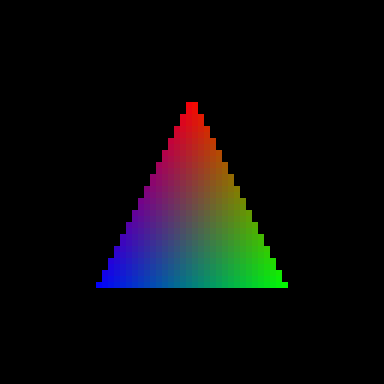

# GreenMetal

<p>
  
  
  
  
  <a href="#help-wanted"></a>
</p>

**Metal on NVIDIA Maxwell cards under macOS 26 Tahoe, for hackintoshes.** An experimental, open driver stack that gives a GTX 960 a working
Metal device, and a Metal-composited desktop, on an OS that dropped NVIDIA years ago.

🇧🇷 [Leia em português](README.pt-BR.md)

<p align="center">
  
  <br><em>The first triangle the GTX 960 drew through this stack (NVK over the r387 resource manager).</em>
</p>

> [!WARNING]
> This is a lab project, not a product. The installer is alpha and has been through one machine. It needs SIP partly disabled, it loads third-party kexts,
> and a mistake leaves you at a black screen or a kernel panic. Do not try it without a bootable backup of your EFI and
> a clone of your system. **Help is wanted**: see [Help wanted](#help-wanted).

## What this is

Apple's last NVIDIA drivers stopped at Kepler, and NVIDIA's own Web Drivers stopped at High Sierra. On Tahoe a Maxwell
card gets OpenGL from the old Web Driver at best, and no Metal at all, so WindowServer composites on the CPU.

[NullMoth's driver](https://github.com/nullmoth/nvidia-macos-driver) brought Metal back for newer NVIDIA cards by putting
a Metal plugin on top of NVK, Mesa's Vulkan driver. Its kernel side runs NVIDIA's open resource manager, which needs GSP
firmware and so only exists for Turing and later. Maxwell has no GSP.

This project keeps the top half of that design and replaces the bottom half. The GPU stays under the control of the
resource manager inside the **NVIDIA Web Driver (r387)**, which already knows how to initialise and clock a Maxwell
card. A user-space library translates what NVK asks for (in the r615 dialect) into what the r387 resource manager
understands, and a small set of kexts provides the accelerator, the framebuffer and the page flip.

The name: in hackintosh vocabulary green is NVIDIA, the way red is AMD and blue is Intel. GreenMetal is Metal for the
green cards Apple left behind.

## Status

Everything below was measured on one machine: **GTX 960 2 GB (GM206), Core i3-6100, macOS 26.7.2, one 1920×1080
display.**

| Area | State |
|---|---|
| GPU runs our command buffers through the r387 resource manager | Works |
| NVK creates a `VkDevice`; compute and triangle tests | Work |
| Metal device visible to the system (`MTLCopyAllDevices`) | Works |
| Metal in sandboxed apps (Chrome GPU process, Find My) | Works |
| Own framebuffer and page flip on the display channel | Works |
| WindowServer compositing on Metal, zero-copy flips | Works when started by a script after boot; about 30 flips/s with a video playing, WindowServer near 45% of one core |
| Metal desktop straight from boot | Not yet; the machine boots to the CPU-composited desktop |
| Stability over hours | Unproven; the longest clean run so far is minutes, not days |
| Wallpaper processes on Metal | Disabled (they spin on a VideoToolbox pipeline); drawn on the CPU |
| Hardware video decode and encode | Not started; the resource manager does expose the NVDEC and NVENC classes |
| Multiple displays, hotplug, sleep and wake, HDMI audio | Untested |
| Ray tracing, mesh shaders, DLSS | Not possible on this hardware |

Known costs of the current design: display surfaces use a 4× wide row (34 MB each at 1080p, capped at ten), reading a
display surface back on the CPU takes about half a second, and the NVK build in use is not an optimised one.

The full lab notebook, in Portuguese and in chronological order, is in [docs/](docs/).

## Is this only for the GTX 960?

By design, no. In practice, today, yes.

- **Only tested on a GTX 960.** Nobody has run this on any other card.
- **Other second-generation Maxwell cards** (GTX 950, 970, 980, 980 Ti, Titan X) use the same Web Driver HAL and the
  same channel and engine classes, so they are the closest. The framebuffer kext matches PCI ID `10de:1401` and
  assumes one 1920×1080 head, and both would need to be widened.
- **First-generation Maxwell** (GTX 750, 750 Ti) uses different class numbers and needs porting.
- **Pascal** (GTX 10xx) is driven by the same Web Driver and supported by NVK, but through a different HAL and
  different classes. That is a real port, not a recompile.
- **Kepler** is an open question.

If you own one of these and can read a kernel panic, you are exactly who this project needs.

## How it works

```
 Metal app / WindowServer
        │
 NVMTLDriver.bundle        Metal plugin from NullMoth, patched            metal/plugin-lib
        │                  (+ NullMoth's AIR→SPIR-V translator, unmodified, not in this repo)
        │
 NVK (Mesa)                Vulkan driver, NAK shader compiler             nvk/patches
   └─ libnvrm387           translates r615 requests to r387               libnvrm387
        │
 ───────┼──────────────────────────────── kernel ───────────────────────────────────────────
        │
 MaxwellAccel.kext         IOAccelerator; port of NullMoth's NVAccel      accel
 MaxwellFB.kext            framebuffer in place of the Web Driver's       fb
 MaxwellAGDC.kext          AppleGraphicsDeviceControl (from NVRMAGDC)     agdc
 MaxwellMetal.kext         kernel backend: VRAM, GPU address space,       kext/MaxwellMetal
        │                  page flip on the display channel
        │
 NVDAResmanWeb.kext        NVIDIA's r387 resource manager, unmodified     (not included)
        │
     GTX 960
```

The key finding is that `NVDAResmanWeb` exports the classic `NvRm*` C API to other kexts and also accepts the same
requests from user space. Nothing from NVIDIA is patched or redistributed; the stack links against the resource manager
that the Web Driver already installed. [`nvrm_r387.h`](nvrm_r387.h) documents that interface as far as it has been
worked out, with every prototype and struct marked as confirmed or inferred.

## Repository layout

| Path | What it is |
|---|---|
| `libnvrm387/` | User-space library: NVK's `nvrm_xnu.h` interface implemented over the r387 resource manager. Has unit tests that run without a GPU. |
| `nvk/` | Our patch for Mesa's NVK, the script that assembles the Mesa tree, and the Vulkan smoke tests. |
| `metal/plugin-lib/` | NullMoth's Metal plugin with our changes (wide-row display surfaces, accelerator probing). |
| `accel/` | `MaxwellAccel.kext`: NullMoth's `NVAccel` ported to the r387 backend. |
| `kext/MaxwellMetal/` | `MaxwellMetal.kext`: the kernel backend and the sandbox bridge. |
| `fb/`, `agdc/` | `MaxwellFB.kext` and `MaxwellAGDC.kext`. |
| `kext/deploy/`, `kext/troca/`, `kext/gpubundles/` | The author's install, switch-over and rollback scripts. They assume the tree lives at `~/maxwell_metal` on the target machine. |
| `tools/` | Probes and small tests written along the way. |
| `nvrm_r387.h` | The r387 resource manager interface, as deduced. |
| `docs/` | Analysis and lab notebook (Portuguese). |

## What you need, and what is not here

This repository contains **no NVIDIA or Apple binaries**. You bring your own:

- A Mac or hackintosh with a Maxwell card on macOS 26, with the **NVIDIA Web Driver 387.10.10.10.40.140** resource
  manager kexts already installed and working (`NVDAStartupWeb`, `NVDAResmanWeb`, `NVDAGM100HalWeb`). Getting them onto
  Tahoe is outside the scope of this project.
- Kext signing and filesystem protections disabled in SIP, and AMFI relaxed, as for any unsigned kext or plugin.
- Xcode command line tools with the macOS 26 SDK. For NVK: Meson, Ninja, Rust with the `x86_64-apple-darwin` target,
  LLVM, SPIRV-LLVM-Translator and glslang.
- NullMoth's [`nvidia-macos-driver`](https://github.com/nullmoth/nvidia-macos-driver) at **v2.7.2** for the parts used
  unmodified: the NVK macOS patch and the shader translator.
- A second machine with `ssh` access to the test machine. You will need it the first time the screen stays black.

## Building and installing

The [releases](../../releases) carry the kexts and the Metal stack prebuilt, with one command, `greenmetal`, in front
of the install scripts. Start with `./greenmetal check`, which is read-only and tells you how close a machine is.

[`docs/INSTALL.md`](docs/INSTALL.md) walks through the whole procedure as the author does it: build, stage, install, switch
over and roll back. Each kext has a `build.sh` next to its sources, [`nvk/README.md`](nvk/README.md) covers NVK, and
`metal/build_plugin.sh` builds the Metal plugin. There is no one-command build yet, and the installer is alpha: it
has been through one machine. Both are things help is wanted for.

## Help wanted

In rough order of how much they would change daily use:

1. **Testers with other cards**, starting with the rest of the GM20x family. Even a report of where it stops is useful.
2. **Metal desktop from boot**, and the stability work to trust it.
3. **Block-linear display surfaces**, to drop the wide row, its VRAM cost and its extra GPU copy.
4. **Surface readback on the copy engine** instead of the CPU.
5. **Hardware H.264 decode** on NVDEC over the r387 resource manager.
6. **The wallpaper pipeline**, multiple displays, sleep and wake, HDMI audio.
7. **A real build system and an installer** that does not assume the author's home directory.
8. **Translating the notes in `docs/` to English.**

[CONTRIBUTING.md](CONTRIBUTING.md) explains how to report results and what to keep out of issues and pull requests.

## Credits

This project stands on other people's work. The short list:

- **[NullMoth Systems](https://github.com/nullmoth/nvidia-macos-driver)**: the Metal plugin, the `NVAccel` accelerator,
  the macOS port of NVK and the shader translator. The whole approach comes from there.
- **[Mesa](https://mesa3d.org) and the NVK and nouveau developers**: the Vulkan driver and the NAK compiler that
  actually drive the card.
- **NVIDIA**: the [open-gpu-kernel-modules](https://github.com/NVIDIA/open-gpu-kernel-modules) and
  [open-gpu-doc](https://github.com/NVIDIA/open-gpu-doc) headers.
- **[Acidanthera](https://github.com/acidanthera)** (OpenCore, Lilu, WhateverGreen), **AMFIPass** and
  **[OpenCore Legacy Patcher](https://github.com/dortania/OpenCore-Legacy-Patcher)**, which made the test machine
  possible.

The complete list, with licences and what came from where, is in [NOTICE.md](NOTICE.md).

## Licence

Mixed, and **noncommercial** for most of the tree. The parts derived from NullMoth's driver, and the kexts and scripts
written for this project, are under the [PolyForm Noncommercial License 1.0.0](LICENSES/PolyForm-Noncommercial-1.0.0.md).
The Mesa patch, `libnvrm387`, `nvrm_r387.h` and `tools/` are under the [MIT licence](LICENSES/MIT.txt). See
[LICENSE](LICENSE) for the map.

## Disclaimer

Not affiliated with, endorsed by or supported by NVIDIA, Apple or NullMoth Systems. All trademarks belong to their
owners. The interface notes in this repository were produced by studying software the author runs on their own machine,
for the purpose of making it work with other software. No warranty of any kind: if it breaks your system, you get to
keep both pieces.
