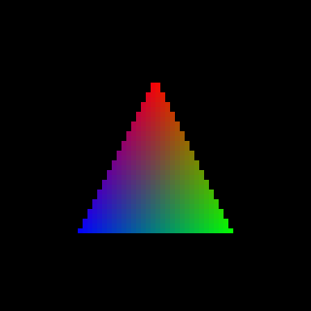

# GreenMetal

<p>
  
  
  
  
  <a href="#onde-preciso-de-ajuda"></a>
</p>

**Metal em placas NVIDIA Maxwell no macOS 26 Tahoe, para hackintosh.** Uma pilha de driver aberta e experimental que dá a uma GTX 960 um
dispositivo Metal funcionando, e a área de trabalho composta por Metal, num sistema que abandonou a NVIDIA há anos.

🇺🇸 [Read in English](README.md)

<p align="center">
  
  <br><em>O primeiro triângulo que a GTX 960 desenhou por esta pilha (NVK sobre o resource manager r387).</em>
</p>

> [!WARNING]
> Isto é um projeto de laboratório, não um produto. O instalador é alfa e passou por uma máquina só. Precisa do SIP parcialmente desligado, carrega
> kexts de terceiros, e um erro te deixa numa tela preta ou num kernel panic. Não tente sem um backup da EFI que dê boot
> e um clone do sistema. **Procuro ajuda**: veja [Onde preciso de ajuda](#onde-preciso-de-ajuda).

## O que é

Os últimos drivers NVIDIA da Apple pararam na Kepler, e os Web Drivers da própria NVIDIA pararam no High Sierra. No
Tahoe, uma placa Maxwell consegue no máximo OpenGL pelo Web Driver antigo, e nenhum Metal. O WindowServer compõe a tela
pela CPU.

O [driver do NullMoth](https://github.com/nullmoth/nvidia-macos-driver) trouxe o Metal de volta para placas NVIDIA
mais novas, com um plugin Metal em cima do NVK, o driver Vulkan do Mesa. A parte de kernel dele roda o resource manager
aberto da NVIDIA, que depende do firmware GSP e por isso só existe da Turing em diante. A Maxwell não tem GSP.

Este projeto mantém a metade de cima daquele desenho e troca a de baixo. A GPU continua sob o controle do resource
manager do **NVIDIA Web Driver (r387)**, que já sabe inicializar e controlar o clock de uma Maxwell. Uma biblioteca de
user space traduz o que o NVK pede (no dialeto r615) para o que o resource manager r387 entende, e um conjunto pequeno
de kexts fornece o acelerador, o framebuffer e a troca de página.

O nome: no vocabulário do hackintosh, verde é NVIDIA, como vermelho é AMD e azul é Intel. GreenMetal é o Metal para as
placas verdes que a Apple deixou para trás.

## Estado

Tudo abaixo foi medido numa máquina só: **GTX 960 2 GB (GM206), Core i3-6100, macOS 26.7.2, um monitor 1920×1080.**

| Área | Estado |
|---|---|
| A GPU executa nossos comandos pelo resource manager r387 | Funciona |
| O NVK cria um `VkDevice`; testes de compute e triângulo | Funcionam |
| Dispositivo Metal visível para o sistema (`MTLCopyAllDevices`) | Funciona |
| Metal em apps com sandbox (processo de GPU do Chrome, Buscar) | Funciona |
| Framebuffer próprio e troca de página no canal de display | Funciona |
| WindowServer compondo por Metal, com flip sem cópia | Funciona quando ligado por script depois do boot; perto de 30 flips/s com vídeo tocando, WindowServer em torno de 45% de um núcleo |
| Área de trabalho em Metal direto do boot | Ainda não; a máquina sobe na área de trabalho composta pela CPU |
| Estabilidade por horas | Não provada; a rodada limpa mais longa até agora é de minutos, não de dias |
| Processos de papel de parede com Metal | Desligado (eles travam num pipeline do VideoToolbox); desenham pela CPU |
| Decodificação e codificação de vídeo por hardware | Não começou; o resource manager expõe as classes NVDEC e NVENC |
| Vários monitores, hotplug, dormir e acordar, áudio HDMI | Não testado |
| Ray tracing, mesh shaders, DLSS | Impossível neste hardware |

Custos conhecidos do desenho atual: as superfícies de tela usam uma linha 4× mais larga (34 MB cada em 1080p, com teto
de dez), ler uma superfície de tela de volta pela CPU leva cerca de meio segundo, e o build do NVK em uso não é o
otimizado.

O caderno de laboratório completo, em ordem cronológica, está em [docs/](docs/).

## Isso é só para a GTX 960?

No desenho, não. Na prática, hoje, sim.

- **Só foi testado numa GTX 960.** Ninguém rodou isso em outra placa.
- **As outras Maxwell de segunda geração** (GTX 950, 970, 980, 980 Ti, Titan X) usam o mesmo HAL do Web Driver e as
  mesmas classes de canal e de engine, então são as mais próximas. O kext de framebuffer casa com o PCI ID `10de:1401`
  e assume um head só em 1920×1080; os dois precisariam ser generalizados.
- **A Maxwell de primeira geração** (GTX 750, 750 Ti) usa outros números de classe e precisa de porte.
- **A Pascal** (GTX 10xx) é dirigida pelo mesmo Web Driver e suportada pelo NVK, mas por outro HAL e outras classes.
  É um porte de verdade, não uma recompilação.
- **A Kepler** é uma pergunta em aberto.

Se você tem uma dessas e sabe ler um kernel panic, é exatamente de você que o projeto precisa.

## Como funciona

```
 App Metal / WindowServer
        │
 NVMTLDriver.bundle        plugin Metal do NullMoth, alterado             metal/plugin-lib
        │                  (+ tradutor AIR→SPIR-V do NullMoth, sem alteração, fora deste repositório)
        │
 NVK (Mesa)                driver Vulkan, compilador de shaders NAK       nvk/patches
   └─ libnvrm387           traduz pedidos r615 para r387                  libnvrm387
        │
 ───────┼──────────────────────────────── kernel ───────────────────────────────────────────
        │
 MaxwellAccel.kext         IOAccelerator; porte do NVAccel do NullMoth    accel
 MaxwellFB.kext            framebuffer no lugar do do Web Driver          fb
 MaxwellAGDC.kext          AppleGraphicsDeviceControl (do NVRMAGDC)       agdc
 MaxwellMetal.kext         backend no kernel: VRAM, espaço de endereços   kext/MaxwellMetal
        │                  da GPU, troca de página no canal de display
        │
 NVDAResmanWeb.kext        resource manager r387 da NVIDIA, intocado      (não incluído)
        │
     GTX 960
```

A descoberta central é que o `NVDAResmanWeb` exporta a API C clássica `NvRm*` para outros kexts e também aceita os
mesmos pedidos vindos de user space. Nada da NVIDIA é alterado ou redistribuído; a pilha se liga ao resource manager
que o Web Driver já instalou. O [`nvrm_r387.h`](nvrm_r387.h) documenta essa interface até onde ela foi entendida, com
cada protótipo e struct marcado como confirmado ou inferido.

## O que tem em cada pasta

| Caminho | O que é |
|---|---|
| `libnvrm387/` | Biblioteca de user space: a interface `nvrm_xnu.h` do NVK implementada sobre o resource manager r387. Tem testes que rodam sem GPU. |
| `nvk/` | Nosso patch para o NVK do Mesa, o script que monta a árvore do Mesa e os testes de Vulkan. |
| `metal/plugin-lib/` | O plugin Metal do NullMoth com as nossas mudanças (superfície de tela com linha larga, leitura do acelerador). |
| `accel/` | `MaxwellAccel.kext`: o `NVAccel` do NullMoth portado para o backend r387. |
| `kext/MaxwellMetal/` | `MaxwellMetal.kext`: o backend no kernel e a ponte para apps com sandbox. |
| `fb/`, `agdc/` | `MaxwellFB.kext` e `MaxwellAGDC.kext`. |
| `kext/deploy/`, `kext/troca/`, `kext/gpubundles/` | Scripts de instalação, de troca e de volta do autor. Assumem a árvore em `~/maxwell_metal` na máquina de teste. |
| `tools/` | Sondas e testes pequenos escritos pelo caminho. |
| `nvrm_r387.h` | A interface do resource manager r387, como foi deduzida. |
| `docs/` | Análise e caderno de laboratório. |

## O que você precisa, e o que não está aqui

Este repositório **não tem nenhum binário da NVIDIA nem da Apple**. Você traz os seus:

- Um Mac ou hackintosh com placa Maxwell no macOS 26, com os kexts do resource manager do **NVIDIA Web Driver
  387.10.10.10.40.140** já instalados e funcionando (`NVDAStartupWeb`, `NVDAResmanWeb`, `NVDAGM100HalWeb`). Colocá-los
  no Tahoe está fora do escopo deste projeto.
- Assinatura de kext e proteção de sistema de arquivos desligadas no SIP, e o AMFI relaxado, como para qualquer kext ou
  plugin sem assinatura.
- Command Line Tools do Xcode com o SDK do macOS 26. Para o NVK: Meson, Ninja, Rust com o alvo `x86_64-apple-darwin`,
  LLVM, SPIRV-LLVM-Translator e glslang.
- O [`nvidia-macos-driver`](https://github.com/nullmoth/nvidia-macos-driver) do NullMoth na **v2.7.2**, para as partes
  usadas sem alteração: o patch do NVK para macOS e o tradutor de shaders.
- Uma segunda máquina com acesso por `ssh` à máquina de teste. Você vai precisar na primeira vez que a tela ficar preta.

## Como compilar e instalar

As [releases](../../releases) trazem os kexts e a pilha Metal já compilados, com um comando só, `greenmetal`, na frente
dos scripts de instalação. Comece pelo `./greenmetal check`, que só lê e diz o quanto uma máquina está perto.

O [`docs/INSTALL.pt-BR.md`](docs/INSTALL.pt-BR.md) mostra o procedimento inteiro como o autor faz: compilar, arrumar os
binários, instalar, trocar e voltar. Cada kext tem um `build.sh` ao lado dos fontes, o [`nvk/README.md`](nvk/README.md)
cobre o NVK, e o `metal/build_plugin.sh` compila o plugin Metal. Ainda não existe build único, e o instalador é alfa: passou por uma
máquina só. São duas coisas em que preciso de ajuda.

## Onde preciso de ajuda

Mais ou menos na ordem de quanto mudariam o uso do dia a dia:

1. **Gente para testar em outras placas**, começando pelo resto da família GM20x. Até um relato de onde parou serve.
2. **Área de trabalho em Metal desde o boot**, e o trabalho de estabilidade para confiar nela.
3. **Superfícies de tela em block-linear**, para acabar com a linha larga, o custo de VRAM e a cópia extra na GPU.
4. **Leitura de superfície pelo copy engine** em vez da CPU.
5. **Decodificação de H.264 por hardware** no NVDEC, sobre o resource manager r387.
6. **O pipeline do papel de parede**, vários monitores, dormir e acordar, áudio HDMI.
7. **Um sistema de build de verdade e um instalador** que não dependa da pasta pessoal do autor.
8. **Traduzir as notas de `docs/` para o inglês.**

O [CONTRIBUTING.md](CONTRIBUTING.md) (em inglês) explica como relatar resultados e o que não pode entrar em issues e
pull requests.

## Créditos

Este projeto se apoia no trabalho de outras pessoas. A lista curta:

- **[NullMoth Systems](https://github.com/nullmoth/nvidia-macos-driver)**: o plugin Metal, o acelerador `NVAccel`, o
  porte do NVK para macOS e o tradutor de shaders. A ideia toda vem de lá.
- **[Mesa](https://mesa3d.org) e os desenvolvedores do NVK e do nouveau**: o driver Vulkan e o compilador NAK, que são
  quem de fato dirige a placa.
- **NVIDIA**: os headers do [open-gpu-kernel-modules](https://github.com/NVIDIA/open-gpu-kernel-modules) e do
  [open-gpu-doc](https://github.com/NVIDIA/open-gpu-doc).
- **[Acidanthera](https://github.com/acidanthera)** (OpenCore, Lilu, WhateverGreen), o **AMFIPass** e o
  **[OpenCore Legacy Patcher](https://github.com/dortania/OpenCore-Legacy-Patcher)**, que tornaram a máquina de teste
  possível.

A lista completa, com as licenças e o que veio de onde, está no [NOTICE.md](NOTICE.md).

## Licença

Mista, e **não comercial** na maior parte da árvore. As partes derivadas do driver do NullMoth, e os kexts e scripts
escritos para este projeto, estão sob a [PolyForm Noncommercial License 1.0.0](LICENSES/PolyForm-Noncommercial-1.0.0.md).
O patch do Mesa, a `libnvrm387`, o `nvrm_r387.h` e a pasta `tools/` estão sob a [licença MIT](LICENSES/MIT.txt). O
mapa está em [LICENSE](LICENSE).

## Aviso

Sem vínculo, endosso ou suporte da NVIDIA, da Apple ou da NullMoth Systems. As marcas pertencem aos seus donos. As
notas de interface deste repositório vêm do estudo de software que o autor roda na própria máquina, com o objetivo de
fazê-lo funcionar com outro software. Sem garantia nenhuma: se quebrar o seu sistema, os cacos são seus.
